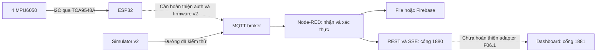

# Smart Posture Tracker

Hệ thống dùng ESP32 và bốn MPU6050 để ước lượng đường cong bề mặt lưng 2D, theo dõi góc và tổng hợp phiên. Đường cong không phải mô hình giải phẫu chính xác và không dùng để chẩn đoán y khoa.

## Đọc phần này trước khi nối mạch

**Đã có cơ chế nhận dữ liệu qua MQTT ở backend. Tuy nhiên, firmware ESP32 hiện tại chưa tương thích giao thức v2 của backend và dashboard chưa nối adapter dữ liệu thật. Cắm USB/nạp firmware xong chưa làm dashboard hiển thị dữ liệu cảm biến.**

| Chặng | Hiện trạng đã đối chiếu source |
|---|---|
| MPU6050 → ESP32 | Có đọc bốn kênh TCA9548A và tính Pitch; cần kiểm chứng trên mạch thật |
| ESP32 → MQTT broker | Có code Wi-Fi và publish JSON cũ; cấu hình còn placeholder, chưa gửi username/password |
| Broker → backend | Có MQTT subscriber, validator v2, quản lý phiên, lưu trữ và REST/SSE; đã kiểm thử bằng simulator |
| Firmware hiện tại → backend v2 | **Chưa nối được trực tiếp**: thiếu auth và schema/boot/session/state/sequence/revision v2 |
| Backend → dashboard cổng 1881 | Có API/client REST/SSE và các điểm nối, **chưa có adapter production hoàn chỉnh** |
| Dashboard Simulation | Chạy độc lập, dữ liệu tự sinh trong model; không chứng minh đang nhận ESP32 |
| USB/Serial → backend | **Chưa có** bộ nhận dữ liệu Serial; USB hiện để nạp, cấp nguồn và xem log |

Đường dữ liệu đích:



Không có kết nối WebSocket trực tiếp từ ESP32 đến trình duyệt trong firmware hiện tại. Socket.IO bên trong FlowFuse Dashboard phục vụ giao diện, không thay đường nhận MQTT của thiết bị.

## Tài liệu bàn giao theo công việc

| Bạn cần làm gì? | Đọc ở đâu? |
|---|---|
| Đấu ESP32, TCA9548A, bốn MPU6050; kiểm tra chân/kênh/nguồn | [Hướng dẫn phần cứng](hardware/README.md) |
| Nạp firmware, xem Serial, biết vì sao chưa có dữ liệu | [Firmware và kiểm tra mạch](hardware/README.md#4-nạp-firmware-và-kiểm-tra-mạch) |
| Cho ESP32 truy cập broker LAN; hoàn thiện firmware/backend/dashboard | [Tích hợp thiết bị thật và trạng thái đường nhận](docs/device-integration.md) |
| Chạy backend/simulator; cấu hình Firebase hoặc Internet | [Setup](docs/setup.md) |
| Xem payload, topic, ACK/state/session/revision v2 | [MQTT contract](docs/mqtt-contract.md) và [JSON mẫu](backend/integrations/mqtt/examples/) |
| Kết nối frontend với backend | [API REST/SSE](docs/api.md) và [dashboard README](frontend/dashboard/README.md) |
| Hiểu đo góc và dựng ba cung | [Giải thích từng bước](docs/F02.1-giai-thich.md), [contract F02.1](docs/F02.1.md) |
| Xem kiến trúc, phạm vi và nghiệm thu | [Kiến trúc](docs/architecture.md), [PLAN](docs/PLAN.md), [báo cáo F02.1](docs/F02.1-report.md) |

## 1. Đấu mạch theo cấu hình hiện tại

Firmware dùng `board = esp32dev` (ESP32 classic), SDA GPIO21, SCL GPIO22, TCA9548A địa chỉ `0x70`, MPU6050 địa chỉ `0x68`.

```text
ESP32 GPIO21 (SDA) ── TCA SDA
ESP32 GPIO22 (SCL) ── TCA SCL
ESP32 GND ─────────── TCA GND + GND cả bốn MPU6050

TCA kênh 0: SD0 → SDA, SC0 → SCL của P1 (lưng trên)
TCA kênh 1: SD1 → SDA, SC1 → SCL của P2 (giữa trên)
TCA kênh 2: SD2 → SDA, SC2 → SCL của P3 (giữa dưới)
TCA kênh 3: SD3 → SDA, SC3 → SCL của P4 (lưng dưới)
```

Phương án nguồn/I2C trong hướng dẫn là **logic 3.3 V**, dùng các breakout hỗ trợ nguồn tương ứng. Nối chung GND, giữ A0/A1/A2 của TCA ở LOW và AD0 của từng MPU ở LOW. Kiểm tra pull-up/RESET và chân nguồn trên đúng module trước khi cấp điện; không suy ra chân VIN/VCC của mọi breakout là giống nhau. Bảng nối đầy đủ và lưu ý điện áp nằm trong [hardware/README.md](hardware/README.md#2-sơ-đồ-đấu-mạch).

Thứ tự kênh 0→3 trên là mapping người lắp phải thực hiện. Code hiện không tự nhận biết module nào đang ở lưng trên hoặc lưng dưới.

## 2. Chạy dashboard để trải nghiệm — chưa cần ESP32

Yêu cầu Node.js >=22.9. Từ root repository:

```powershell
cd frontend/dashboard
npm ci
npm run build
npm run demo
```

Mở http://127.0.0.1:1881/spt/dashboard. Các trang Nhật ký/Tiến trình/Cài đặt thuộc cùng bản mô phỏng. Nút bắt đầu, mốc và nhắc rung dùng ACK mô phỏng; không điều khiển mạch thật.

Demo toán học riêng: tại root chạy `node frontend/geometry-demo/serve.js`, mở http://127.0.0.1:1882/frontend/geometry-demo/. Hai trang 1881 và 1882 đều cần tiến trình server tương ứng còn chạy. Ctrl+C dừng tiến trình.

## 3. Chạy thử đường nhận MQTT/backend bằng simulator

Từ root, mở terminal thứ nhất:

```powershell
cd backend
npm ci
npm run configure
npm run broker
```

Mở hai terminal khác, **đều tại thư mục `backend`**:

```powershell
# Terminal thứ hai
npm start
```

```powershell
# Terminal thứ ba
npm run simulator
```

`configure` tạo `backend/.env` chứa credential local, không ghi đè tệp có sẵn. Mặc định broker bind `127.0.0.1:1883`, backend API bind `127.0.0.1:1880`. Dữ liệu lưu file local, chưa phải Firebase cloud.

Kiểm tra tại terminal thứ tư trong `backend`:

```powershell
$apiToken = ((Get-Content .env | Where-Object { $_ -like 'API_TOKEN=*' }) -split '=', 2)[1]
$headers = @{ Authorization = "Bearer $apiToken" }
Invoke-RestMethod http://127.0.0.1:1880/api/v1/health -Headers $headers
Invoke-RestMethod http://127.0.0.1:1880/api/v1/devices -Headers $headers
```

Kỳ vọng `mqtt_connected=true`, `protocol_version=2` và state của simulator. Simulator cần nhận START trước khi có telemetry. Cách START/STOP và kiểm tra data trong [setup](docs/setup.md#1-chạy-local-không-cần-tài-khoản-cloud). Đây là đường nhận MQTT thật với **thiết bị mô phỏng**, không phải số đo MPU6050.

## 4. Muốn thay simulator bằng ESP32 thật

Làm theo thứ tự trong [hướng dẫn tích hợp](docs/device-integration.md):

1. Đấu mạch, nạp và kiểm tra `MPU 0..3: READY` qua Serial 115200.
2. Đưa broker ra địa chỉ LAN mà ESP32 truy cập được, giữ auth/ACL. `127.0.0.1` trên ESP32 không phải máy tính của bạn.
3. Hoàn thiện MQTT credential và firmware v2: state/heartbeat, boot, command/session, ACK, revision và payload. Firmware hiện tại **chưa có đủ các phần này**.
4. Dừng simulator cùng device/client ID. Xác nhận state thiết bị thật, START applied, telemetry và dữ liệu lưu được qua API.
5. Hoàn thiện adapter REST/SSE→Dashboard và đường gửi lệnh. Chỉ đổi `SPT_MODE` không tự nối frontend với backend.
6. Kiểm tra timestamp, chất lượng từng sensor, quy ước góc và đồng bộ trước khi gọi F02.1. Một timestamp tổng chưa chứng minh bốn mẫu đồng bộ.

Không đổi validator để nhận JSON cũ bằng cách tự gán boot/session/góc 0. Những trường đó phải có căn cứ từ quá trình thu nhận và quản lý phiên.

## 5. Các cổng và cách kết nối

| Cổng mặc định | Dùng cho | ESP32 có dùng không? |
|---|---|---|
| USB / COMx | Upload và Serial Monitor 115200 | Nạp/debug, không phải đường nhận backend hiện tại |
| TCP 1883 | MQTT broker | Có, qua Wi-Fi; phải cấu hình LAN và credential |
| HTTP 1880 | Backend REST/SSE `/api/v1` | Firmware hiện không gửi HTTP tới đây |
| HTTP 1881 | Dashboard FlowFuse `/spt/dashboard` | Trình duyệt mở; chưa nối data thật |
| HTTP 1882 | Demo hình học `/frontend/geometry-demo/` | Không dùng bởi firmware |

## 6. Cấu trúc repository

| Thư mục | Nội dung |
|---|---|
| `hardware/firmware/` | PlatformIO/Arduino: I2C, lọc góc, FreeRTOS queue, MQTT legacy |
| `backend/` | Node-RED, MQTT v2, API, persistence, broker/config và simulator |
| `frontend/dashboard/` | Dashboard 2.0, state machine demo, Vue/CSS và flow sinh ra |
| `frontend/assets/js/posture-api.js` | Client REST/SSE có Bearer token, chưa nối vào dashboard |
| `frontend/geometry-demo/` | Công cụ kiểm chứng toán học độc lập |
| `shared/geometry/` | Core F02.1 và adapter F01/v2, dùng được trong Node/browser |
| `docs/` | Đấu nối/tích hợp, contract, setup, API và giải thích thuật toán |
| `tests/` | Backend, geometry, C++ host và browser smoke |

## 7. Kiểm thử

```powershell
# Từ root, không cần phần cứng
node --test tests/geometry/*.test.js
node tests/firmware/run-tests.js

# Tại backend
npm test
npm run check

# Tại frontend/dashboard
npm test
# Mở npm run demo ở terminal khác trước:
npm run test:browser
```

Test C++ host cần g++ trong PATH hoặc biến `CXX`, không phải build/nạp ESP32. Firebase Emulator và `test:firebase` xem [setup](docs/setup.md). Test không có phần cứng không chứng minh đấu dây, nguồn, hướng lắp, noise, Wi-Fi hoặc motor thật đã hoạt động.
