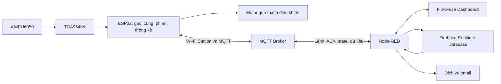
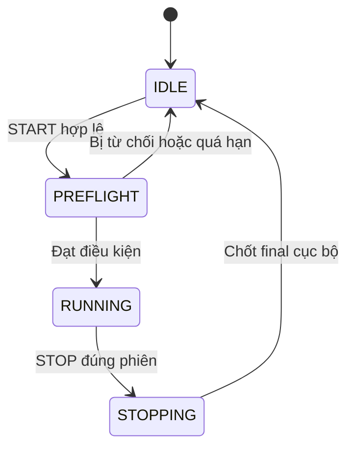

# Kế hoạch phát triển Smart Posture Tracker

Ngày lập: **11/11/2026**. Phạm vi: phiên bản đầu của **IoT_KhoGaMixi**, hoàn thành trong khung **8 tuần** tính từ khi nhóm bắt đầu triển khai, chưa gán ngày kết thúc cụ thể.

Tài liệu này chuyển ý tưởng và các hướng giải quyết đã thống nhất thành công việc, thứ tự phụ thuộc và tiêu chí nghiệm thu. Đây là kế hoạch triển khai; các chức năng dự kiến dưới đây chưa được coi là đã có hoặc đã kiểm thử.

## 1. Căn cứ, mục tiêu và phạm vi

### 1.1. Tài liệu làm căn cứ

- [PROPOSAL.md](../review/PROPOSAL.md): mục tiêu sản phẩm, yêu cầu môn học, phạm vi phần cứng, chức năng, kiểm chứng và khung tiến độ.
- [Hướng giải quyết đã thống nhất](../review/huong_giai_quyet_IoT_KhoGaMixi.md): phân chia tính toán, quy ước hình học, MQTT, chất lượng dữ liệu và quản lý phiên.
- Mã nguồn được đối chiếu tại commit `dd86c095e88d7ca8f5a653d25514933a113c8e00`. Hai tài liệu trong `review/` là đầu vào hiện có tại thời điểm lập kế hoạch, không được giả định đã nằm trong commit này.

Giữ phạm vi sản phẩm của proposal và áp dụng bốn hướng giải quyết cho thiết kế triển khai. Những chi tiết bổ sung trong kế hoạch được ghi là quy tắc bản đầu hoặc công việc cần chốt. Khi thay đổi quyết định, cập nhật tài liệu liên quan và phiên bản giao thức trước khi tích hợp.

### 1.2. Kết quả cần đạt

Thiết bị đeo dùng **01 ESP32, 04 MPU6050, 01 TCA9548A và 01 motor rung** để theo dõi Pitch tại bốn vị trí trên lưng. Website qua Internet hiển thị số đo, đường cong bề mặt lưng 2D ước lượng từ ba cung tròn, điều khiển phiên học và nhắc rung. Firebase lưu lịch sử; Node-RED gửi email cho sự kiện lệch kéo dài theo cấu hình.

Nguồn thử ban đầu là USB hoặc pin dự phòng USB. Kiểm tra nguồn và mức logic I²C phù hợp 3,3 V trước khi đấu nối; pin LiPo/mạch sạc riêng chỉ xét ở phần mở rộng sau khi thiết kế nguồn được kiểm chứng.

| Mã | Chức năng bắt buộc | Kết quả người dùng nhận được |
|---|---|---|
| F01 | Thu nhận và mô hình 2D | Bốn Pitch, ba góc tương đối, tình trạng cảm biến và ba cung cập nhật trực tiếp |
| F02 | Quản lý phiên | Start/Stop trên website, có kiểm tra trước phiên và xác nhận của ESP32 |
| F03 | Thống kê | Thời lượng hợp lệ, histogram, trung bình/cực đại góc, timeline và nhật ký sự kiện |
| F04 | Nhắc tại thiết bị | Rung sau thời gian vượt ngưỡng liên tục, có hysteresis và cooldown |
| F05 | Điều khiển từ Internet | Bật/tắt nhắc, chỉnh tham số, thiết lập mốc cá nhân và Test Vibration |
| F06 | Lịch sử cloud | Xem lại phiên, báo cáo ngày và 7 ngày sau khi tải lại hoặc đổi thiết bị truy cập |
| F07 | Email | Sự kiện kéo dài được lưu, gửi theo cấu hình và có trạng thái xử lý dịch vụ |
| F08 | Xử lý lỗi | Mất cảm biến, dữ liệu cũ, mất mạng và reboot được thể hiện rõ, không gán nhầm phiên |

Tên hiển thị phải thể hiện đây là **mô phỏng đường cong bề mặt lưng ước lượng**. Số đo và các mức góc không xác nhận tư thế đúng/sai, bệnh lý hoặc độ cong xương sống lâm sàng. Camera chỉ có thể dùng làm công cụ đối chiếu khi thử nghiệm, không làm cảm biến vận hành chính.

### 1.3. Phần mở rộng và ngoài phạm vi

Chỉ xét sau khi bản bốn cảm biến đạt nghiệm thu: cảm biến thứ năm/cung thứ tư, Writing Mode, ghi chú phiên, phân tích xu hướng tuần nâng cao, Roll có hiệu chuẩn, Kalman, nguồn pin riêng và journal offline bền vững. Lịch sử cơ bản ngày/7 ngày vẫn thuộc bản bắt buộc.

Không đưa AI phân loại tư thế, nhận dạng chắc chắn hoạt động, chẩn đoán bệnh, mô hình cột sống 3D, GPS hoặc cam kết sửa tư thế vào bản đầu. Không dùng dashboard Blynk dựng sẵn thay phần nhóm tự phát triển.

## 2. Bốn quyết định triển khai đã thống nhất

| Mã | Quyết định | Hệ quả đối với codebase |
|---|---|---|
| D01 | Đồng bộ tài liệu với thiết kế và mã nguồn | Viết lại architecture/setup/MQTT contract và README; ghi rõ đã chọn, đã triển khai, đã kiểm thử |
| D02 | ESP32 là nguồn tính chính | Góc, chất lượng, cung, thống kê, sự kiện và rung thuộc firmware; Node-RED điều phối, lưu trữ, báo cáo và email |
| D03 | Thống nhất dấu góc và hệ trục | Kiểm tra mapping dây/hướng lắp trước khi sửa dấu; dùng một quy ước xuyên suốt mô hình, payload và biểu đồ |
| D04 | START tạo phiên có kiểm tra và xác nhận | State machine, preflight, command/result queue, ID phiên tại frame và xử lý lệnh lặp phải có trước tích hợp hoàn chỉnh |

Công nghệ bản đầu: **VS Code + PlatformIO**, Arduino framework cho ESP32; **MQTT**, **Node-RED**, **FlowFuse Dashboard** và **Firebase Realtime Database**. Chưa cần thêm Express/FastAPI chỉ để trung chuyển dữ liệu. Arduino IDE chỉ là đường phụ nếu nhóm chủ động duy trì và kiểm tra riêng.

## 3. Hiện trạng và khoảng cách cần hoàn thiện

Đánh giá dưới đây dựa trên việc đọc mã nguồn, chưa xác nhận build hoặc phần cứng.

| Phần | Đã có trong repository | Cần triển khai hoặc sửa |
|---|---|---|
| Khởi tạo/thu nhận | `sensor_setup.*`, `mpu_reader.*`; bốn kênh TCA, đọc accel/gyro | Xử lý kết quả khởi tạo, mapping có cấu hình, chẩn đoán, timestamp và đồng bộ khung đo |
| Góc | `angle_calculator.*`, Complementary Filter, cờ hợp lệ | Kiểm chứng trục, bias/offset, revision, chất lượng/warm-up và dấu relative |
| Tổ chức tác vụ | `main.cpp`, hai task FreeRTOS, queue frame mới nhất | Chủ sở hữu trạng thái, preflight, queue lệnh/kết quả/sự kiện và kiểm tra tạo task |
| MQTT | Wi-Fi Station, telemetry, START/STOP/CONFIG, ACK cơ bản | Contract v2, danh tính phiên, state/summary/event/receipt, retry, TLS và cấu hình cục bộ |
| Hình học/phiên | Chưa có module tương ứng | Curve builder, session manager, thống kê, sự kiện và điều khiển motor |
| Backend/frontend | README, cấu hình ví dụ và các thư mục giữ chỗ | Package/flow Node-RED, dashboard, Firebase, email và phục hồi trạng thái |
| Kiểm thử/tài liệu | `tests/` giữ chỗ; docs còn placeholder | Fixtures, runner phù hợp, phép thử phần cứng, kết quả đo và hướng dẫn chạy thực tế |

Các vấn đề hiện hữu cần xử lý: `relative` đang lấy `pitch[i+1]-pitch[i]`; START bật cờ ngay; `main.cpp` bỏ qua kết quả `setupSensors()`; khi IDLE task liên tục reset filter và không thu nhận. Payload chưa có boot/session/sequence, dùng `micros()` 32 bit; JSON/MQTT buffer đang đặt 512 byte. Broker LAN và `WiFiClient` hiện tại chưa đáp ứng bản demo Internet có TLS.

## 4. Kiến trúc và trách nhiệm



| Thành phần | Trách nhiệm chính |
|---|---|
| ESP32 | I²C, quy đổi trục, lọc, chất lượng, ba cung, quản lý phiên, tính thời lượng/sự kiện và điều khiển motor |
| MQTT Broker | Chuyển message theo topic và quyền truy cập; không thay ACK thực thi của thiết bị |
| Node-RED | Sinh session/command ID, điều phối pending/retry, kiểm tra message, lưu cloud, tổng hợp nhiều phiên và email |
| Frontend | Hiển thị, lấy điểm vẽ từ cung đã xác định, biểu đồ, lịch sử, cấu hình và trạng thái xác nhận |
| Firebase RTDB | Metadata, snapshot cấu hình, tổng hợp định kỳ, keyframe, sự kiện, final và trạng thái lệnh |

Backend/frontend chỉ tái dựng lịch sử hoặc đối chiếu bằng đúng algorithm version và snapshot cấu hình; kết quả tính lại phải có nguồn/phiên bản riêng. Không cộng thống kê do backend tính lại với thống kê ESP32 của cùng một phiên.

### Nhịp xử lý dự kiến

| Công việc | Giá trị khởi đầu/mục tiêu | Điều kiện cần xác minh |
|---|---|---|
| Thu nhận/lọc | 50 Hz, chu kỳ mục tiêu 20 ms | Thời gian đọc bốn kênh, skew, jitter và deadline thực tế |
| Telemetry trực tiếp | 10 Hz, mặc định 100 ms/gói | Độ trễ, băng thông và áp lực queue |
| Summary cộng dồn | Mỗi 5 giây, có cấu hình | Payload và khả năng ghi cloud |
| Keyframe lịch sử | Mỗi 5 giây trong bản đầu | Hiển thị đúng độ phân giải và ghi gap |
| PREFLIGHT | Cửa sổ ổn định 2 giây, timeout 5 giây | Độ ổn định filter và nhiễu đo thực tế |

Các giá trị này là cấu hình khởi đầu để thử nghiệm. Ngưỡng gia tốc, gyro, độ lệch thời điểm, độ mới, sai số góc/đường cong và độ trễ chấp nhận được phải được đo, ghi nhận rồi chốt trước nghiệm thu.

## 5. Quy ước cảm biến, góc và hình học

### 5.1. Mapping và hiệu chuẩn

| Đại lượng | Quy ước triển khai |
|---|---|
| Thứ tự index | `0=P1`, `1=P2`, `2=P3`, `3=P4`, từ trên xuống dưới |
| Kênh TCA mặc định | Kênh 0–3 tương ứng P1–P4; phải đối chiếu dây thật |
| Phần cứng I²C hiện có | SDA GPIO21, SCL GPIO22, TCA `0x70`, MPU `0x68`, bus 100 kHz |
| Pitch `θ` | Góc tiếp tuyến hướng từ dưới lên, đo từ trục đứng; dương khi nghiêng về trước |
| Tọa độ hình học | P4=(0,0), x dương về trước, y dương lên trên; đơn vị mm |
| Khoảng cách | `[d12,d23,d34]`, đo dọc đường gắn, dùng như chiều dài cung giả định |
| Góc truyền/lưu | Degree; relative `[θ1−θ2, θ2−θ3, θ3−θ4]` sau chuẩn hóa góc |
| Hình học nội bộ | Radian; độ cong có dấu, đơn vị `1/mm` |
| Thứ tự cung | P4→P3 dùng d34; P3→P2 dùng d23; P2→P1 dùng d12 |

Đánh dấu trục trên module và đồ gá; đo 0°, +20°, −20° bằng chuẩn ngoài. Xác định mapping/ma trận quay cho mỗi cảm biến và áp dụng nhất quán lên accel/gyro; bù gyro bias, offset lắp và lưu calibration revision. Góc accel và dự đoán gyro phải tăng cùng chiều khi quay theo chiều dương.

Không tự đổi trục gyro hoặc sao chép nguyên công thức trong paper khi chưa kiểm tra hướng lắp. Sửa relative thành `normalizeAngle(pitch[i] - pitch[i + 1])` sau khi xác nhận mapping. Thay ngữ nghĩa dấu phải đi cùng schema/algorithm version và cập nhật fixture/nhãn chart; dữ liệu cũ được giữ riêng hoặc chuyển đổi có phiên bản.

Hiệu chuẩn thiết bị khác với mốc tư thế cá nhân. Mốc dùng cho độ lệch/nhắc nhở không được xóa chênh góc tự nhiên giữa bốn điểm. Không tự chụp mốc lúc boot hoặc START, không trừ θ4 khỏi toàn bộ góc để dựng đường cong chính. Giữ θ4 thật.

### 5.2. Dựng ba cung

Với đoạn A dưới → B trên, chiều dài `d>0`, góc đã đổi sang radian:

```text
delta = wrapToPi(thetaB - thetaA)
kappa = delta / d
h = delta / 2
m = thetaA + h
sinc(h) = sin(h) / h; sinc(0) = 1
dx = d * sinc(h) * sin(m)
dy = d * sinc(h) * cos(m)
PB = PA + (dx, dy)
```

Khi h gần 0, dùng xấp xỉ `1 - h*h/6` để tránh chia 0. Giữ dấu kappa cho cả hai phía cong; bán kính khi delta khác 0 là `d/abs(delta)`. Ngưỡng đơn giản hóa thành đoạn thẳng để hiển thị được chọn từ nhiễu thực nghiệm, không sửa số đo gốc.

Frontend lấy điểm tại tỷ lệ u trong [0,1] bằng cách thay d bằng u·d và delta bằng u·delta trong cùng công thức. Đây là bước vẽ cung đã xác định. Array relative là `[12,23,34]`, còn cung đi từ dưới lên dùng delta `[relative34,relative23,relative12]`.

Fixture chuẩn từ hai tài liệu nguồn: góc `[32,22,12,5]°`, khoảng cách `[70,70,70]` mm → relative `[10,10,7]°`; P3≈(10.340,69.188), P2≈(30.780,136.044), P1≈(62.519,198.336) mm. Dùng để kiểm tra số học, không coi là tọa độ giải phẫu đã đo.

### 5.3. Chất lượng dữ liệu

Phân biệt tối thiểu: lỗi đọc/mất sensor, nhiễu chuyển động, dữ liệu cũ, filter chưa ổn định và dữ liệu hợp lệ. Trạng thái thiếu mốc cá nhân thuộc khả năng tính metric, không được gộp thành lỗi phần cứng.

Một sensor không hợp lệ: Pitch vị trí đó và relative liên quan là `null`; `curve_valid=false`, `curve=null`. Các số đo còn tốt có thể hiển thị riêng. Không dùng góc cũ hoặc giá trị mặc định để vẽ đủ bốn điểm; không gửi NaN/Infinity trong JSON. Kiểm tra độ lớn gia tốc hiện có chỉ là bước loại nhiễu thô, chưa đủ chứng minh chất lượng tư thế.

## 6. Quản lý phiên và tổ chức firmware

### 6.1. State machine



Trong IDLE có đọc chẩn đoán; PREFLIGHT đọc/lọc ở tần suất vận hành. Chỉ RUNNING mới tích lũy thời gian học. Khi chuyển RUNNING, giữ filter đã ổn định, gắn session ID, thời gian bắt đầu và revision; reset bộ đếm phiên. Lỗi cảm biến trong RUNNING làm giảm chất lượng, không tự tạo session mới.

### 6.2. Điều kiện START

Node-RED tạo bản ghi `pending`, command ID và session ID; đã có snapshot cấu hình khớp thiết bị trước khi phát START. ESP32 kiểm tra:

| Nhóm kiểm tra | Yêu cầu | Mã lỗi dự kiến |
|---|---|---|
| Envelope | Đúng schema/device, ID đúng kiểu/giới hạn độ dài | `INVALID_COMMAND` |
| Boot/độ mới | Đúng target boot; lệnh chưa quá hạn theo đồng hồ của boot đích | `BOOT_MISMATCH`, `COMMAND_EXPIRED` |
| Phiên | Không xung đột phiên/preflight; session chưa đóng | `SESSION_CONFLICT`, `SESSION_CLOSED` |
| Revision | Cấu hình đang áp dụng khớp expected revision | `CONFIG_MISMATCH` |
| Cảm biến | Đủ bốn sensor; đọc mới, đúng cấu hình/kênh | `SENSOR_MISSING`, `SENSOR_CONFIG_INVALID` |
| Hướng lắp | Mapping/hiệu chuẩn phù hợp và đã xác nhận cách đeo | `MOUNTING_NOT_CONFIRMED` |
| Hình học | Ba khoảng cách hữu hạn, >0, đúng đơn vị và trong giới hạn đồ gá đã chốt | `GEOMETRY_INVALID` |
| Tín hiệu | Cửa sổ mẫu mới, ổn định, không gap/skew/chuyển động vượt giới hạn | `SIGNAL_UNSTABLE`, `DATA_STALE` |
| Tài nguyên | Khởi tạo bắt buộc, queue và task đều thành công | `DEVICE_NOT_READY` |
| Mốc cá nhân | Có reference phù hợp nếu yêu cầu chế độ metric/nhắc dựa vào mốc | `REFERENCE_REQUIRED` |

WHO_AM_I không xác nhận vị trí trên cơ thể. Hướng lắp và độ bám cần cơ khí cố định, bảng mapping và bước xác nhận có hướng dẫn; phần mềm chỉ hỗ trợ nhận biết bất thường.

Cho phép START chế độ **chỉ đo** khi chưa có reference: vẫn có góc/cung, metric và nhắc theo reference hiển thị chưa sẵn sàng. Nếu yêu cầu bật ngay chế độ nhắc theo reference mà chưa có mốc thì trả `REFERENCE_REQUIRED`; không tự thay mốc bằng 0°.

### 6.3. Task và queue

| Luồng | Quyền sở hữu và hành vi |
|---|---|
| Sensor/session task | I²C, filter, cấu hình đang áp dụng, state machine, session ID, thống kê, event và yêu cầu motor |
| MQTT callback | Kiểm tra envelope, copy lệnh vào command queue rồi trả nhanh; không chờ preflight |
| MQTT task | Chủ sở hữu duy nhất của PubSubClient; nhận kết quả, serialize, gửi ACK/state/data/summary/event và nhận receipt |
| Telemetry queue | Một phần tử overwrite để lấy frame mới nhất; frame mang ID ngay từ lúc thu nhận |
| Command/result/event/final | Queue hoặc outbox riêng, có giới hạn, ID và chính sách retry; không dùng overwrite queue của telemetry |

Kiểm tra lỗi tạo task/queue và áp lực queue; không đưa owning `String`/`std::string` vào FreeRTOS queue bằng copy byte. Dùng struct chứa mảng ký tự có giới hạn hoặc cơ chế sở hữu rõ ràng. Một cờ atomic không thay được đồng bộ snapshot gồm session/config/timestamp.

### 6.4. Lệnh lặp, chuyển phiên và xác nhận

- ACK `accepted/PREFLIGHT` chỉ báo đang xử lý. Chỉ ACK `applied/RUNNING` hoặc state mới khớp boot/session/config mới xác nhận đã bắt đầu.
- Node-RED chỉ cho một lệnh chuyển trạng thái pending trên mỗi thiết bị; yêu cầu xung đột phải được từ chối hoặc chờ đối chiếu kết quả lệnh trước.
- Retry dùng cùng command ID và nội dung. Khi đang PREFLIGHT, trả trạng thái xử lý hiện tại, không mở lại cửa sổ kiểm tra. Firmware lưu kết quả theo boot/command ID; lệnh đã áp dụng trả lại kết quả cũ kể cả khi deadline thực thi ban đầu đã qua, không reset bộ đếm. Cùng ID khác nội dung bị từ chối.
- START mới không được mở lại session đã đóng. STOP phải nhắm đúng session; STOP cũ không dừng phiên mới. Lệnh chưa thực thi nhắm boot cũ bị từ chối.
- Khi STOP: đóng event đang mở, tắt motor, chốt final/cutoff sequence và giữ bản chờ gửi. ACK STOP applied xác nhận đã dừng; receipt lưu trữ xác nhận final đã lưu cloud.
- Chuyển phiên phải xóa hoặc loại frame/cache cũ theo generation/barrier; backend định tuyến bằng ID có trong gói, không gắn gói muộn vào phiên hiện tại.
- Mất ACK: UI báo chưa xác nhận, Node-RED đối chiếu state mới. Không tự tạo session khác hoặc coi timeout là bằng chứng thiết bị chưa chạy.

Khóa geometry/calibration/reference/algorithm revision trong một phiên. Muốn đổi các đối tượng này phải kết thúc phiên. Publish interval và bật/tắt reminder có thể đổi qua lệnh riêng; thay đổi được ghi lại, không xóa histogram hoặc dừng đo.

## 7. MQTT, định danh và thời gian

### 7.1. Topic và mức bảo đảm

Giữ gốc topic `posture/{device_id}/`. Contract v2 là đích triển khai, chưa phải giao thức đang hoàn chỉnh trong firmware.

| Đuôi topic | Chiều | QoS theo thiết kế dùng PubSubClient hiện tại | Retained |
|---|---|---|---|
| `data` | ESP32 → Node-RED | Publish 0 | false |
| `cmd` | Node-RED → ESP32 | Publish 1, ESP32 subscribe 1 | false |
| `ack` | ESP32 → Node-RED | Publish 0, khôi phục bằng retry/state | false |
| `state` | ESP32 → Node-RED | Live publish 0, có heartbeat/LWT theo contract | true |
| `summary` | ESP32 → Node-RED | Publish 0, xác nhận/retry ứng dụng | false |
| `event` | ESP32 → Node-RED | Publish 0, xác nhận/retry ứng dụng | false |
| `receipt` | Node-RED → ESP32 | Publish 1, ESP32 subscribe 1 | false |

Không ghi publish QoS 1 cho firmware dùng PubSubClient hiện tại. Không retained lệnh START/STOP/Test Vibration. Kiểm tra và xóa retained command cũ nếu môi trường thử trước đây từng dùng; state retained phải kiểm tra tuổi dữ liệu. LWT/heartbeat chỉ hỗ trợ xác định kết nối, không xác nhận STOP.

### 7.2. Các loại message cần đặc tả

| Loại | Nội dung cần có |
|---|---|
| Envelope | `schema_version`, `device_id`, `boot_id` khi bên phát là thiết bị; `session_id` cho dữ liệu thuộc phiên |
| Telemetry | `sample_seq`, `telemetry_seq`, `t_mono_us`, `ts_unix_ms`, revision, `algorithm_version`, bốn `pitch_deg`, ba `relative_deg`, chất lượng, `curve_valid`, `metric_valid`, curve |
| Curve | Thứ tự P4→P1, bốn node mm, ba kappa có dấu; góc đầu/chiều dài truy xuất được qua frame và snapshot |
| START | `command_id`, `session_id`, `target_boot_id`, `expected_config_rev`, `not_after_mono_us`, `preflight_timeout_ms` |
| ACK | Các ID tương ứng, `accepted/applied/rejected`, state, thời điểm áp dụng hoặc `reason/failed_checks` |
| State | `state_seq`, boot, phiên đang chạy hoặc null, thời gian đơn điệu, revision đang áp dụng, chất lượng và thông tin heartbeat |
| Summary/final | Message ID, `summary_seq`, khoảng thời gian bao phủ, bộ đếm cộng dồn, histogram, thống kê góc, số event/rung, chất lượng và dấu final |
| Event | Event ID, loại/metric kích hoạt, thời điểm bắt đầu/kết thúc, thời lượng hợp lệ liên tục, cực đại, rung và yêu cầu email |
| Receipt | ID message đã lưu, device/boot/session, trạng thái lưu và thời gian backend ghi; chỉ phát sau lưu bền thành công |

Mỗi message phải có giới hạn kiểu/độ dài/kích thước, đơn vị, quy tắc null, schema validation và mã lỗi. Event cập nhật nhiều lần phải có revision/update sequence; retry cùng message giữ nguyên ID/nội dung, update cũ không ghi đè update mới. `sample_seq` tăng theo thu nhận, `telemetry_seq` theo gói trực tiếp; bước nhảy sample sequence do giảm tần suất gửi không tự chứng minh mất mạng.

Nhóm lệnh cần có: START, STOP, CONFIG, SET_REFERENCE, bật/tắt reminder, Test Vibration và yêu cầu state/config. Tên chính xác, payload, quyền và trạng thái cho phép được chốt trong `mqtt-contract.md` tại G0. Bản đầu giữ ngưỡng/delay/hysteresis/cooldown cố định trong phiên; chỉnh các tham số này khi IDLE. Bật/tắt reminder và đổi publish interval được phép khi RUNNING.

Khóa chống trùng phải chứa device/boot/session cùng sequence hoặc message ID. Loại schema không hỗ trợ thay vì âm thầm hiểu dữ liệu cũ theo quy ước mới. Summary/event/final có receipt và retry; telemetry mới nhất có thể bỏ qua để giữ độ mới.

### 7.3. Đồng hồ và tài nguyên

Dùng đồng hồ đơn điệu 64 bit, dự kiến `esp_timer_get_time()`, để tính dt và deadline trong cùng boot. Boot ID mới sau mỗi lần khởi động. Khi đồng bộ UTC, gửi `ts_unix_ms`; khi chưa có, giữ null và ghi chất lượng thời gian. `received_at_ms` của Node-RED/Firebase là thời gian nhận/ghi, không thay thời gian đo.

Không dùng `micros()` 32 bit làm ngày/giờ. Dùng phiên thử dài hơn 72 phút để kiểm tra tràn timestamp và bộ đếm. Backend tạo deadline START dựa trên state mới của đúng boot; command replay sau reboot không được thực thi.

Đo kích thước JSON thực tế và cả topic/header MQTT. Có thể bắt đầu thử buffer 2048 byte nhưng phải kiểm tra kết quả cấp phát, payload lớn nhất, giới hạn ID, độ chính xác float, stack/heap và queue. Không coi 2048 byte là bảo đảm cho mọi summary. Chốt dung lượng outbox và hành vi đầy bộ đệm trong contract; giữ số liệu mất/không lưu được, không bỏ im lặng.

## 8. Thống kê, sự kiện và motor

### 8.1. Thời lượng và báo cáo phiên

ESP32 tính thời lượng từ dt thực của mẫu, độc lập với nhịp publish. Dữ liệu IDLE/PREFLIGHT không được cộng vào phiên. Khoảng lỗi/gap không được cộng vào góc cũ hoặc kéo dài sự kiện.

Quy tắc bản đầu: thời gian đo hoàn chỉnh yêu cầu frame đủ bốn cảm biến hợp lệ và còn mới. `valid_measurement_ms` ghi thời gian này; `valid_metric_ms` còn yêu cầu metric đã chọn có đủ reference/cấu hình. Chế độ chỉ đo vẫn có `valid_measurement_ms` dù `valid_metric_ms=0`. Các số đo riêng còn tốt vẫn có thể hiển thị khi frame đầy đủ không hợp lệ.

Metric mặc định là độ lớn chênh góc giữa P1 và mốc cá nhân: `abs(wrapTo180(Pitch_P1 - reference_P1))`, đơn vị degree. Chuẩn hóa chênh góc tránh coi 179° và −179° là lệch 358° thay vì 2°. Các khoảng histogram là `[0,5)`, `[5,10)`, `[10,15)`, `[15,20)`, `[20,25)`, `[25,+∞)` độ; nhãn cuối là **≥25°** để bao gồm đúng 25°. Mỗi dt đủ điều kiện đóng góp vào một khoảng duy nhất:

```text
sum(histogram_ms) = valid_metric_ms
```

Lưu thời gian phiên tổng, thời gian không hợp lệ/không có metric, trung bình có trọng số thời gian và cực đại của bốn Pitch/ba relative, số event và số lần rung. Thống kê góc của bản đầu chỉ dùng frame đủ bốn cảm biến; mẫu số của trung bình là thời lượng đo hợp lệ tương ứng, không phải thời gian phiên tổng hay valid metric time. Khi chưa có thời lượng hợp lệ, trả null thay vì 0. Nếu sau này thống kê riêng sensor từ frame thiếu, phải bổ sung counter thời lượng riêng và đổi schema rõ ràng.

Quy tắc gán dt giữa hai frame, xử lý góc qua biên ±180° khi lấy trung bình và ngưỡng gap phải được đặc tả trong module thống kê, kiểm tra bằng clock giả lập và đóng phần thời gian cuối phiên rõ ràng.

Summary là snapshot cộng dồn, không phải delta để cộng mọi gói nhận được. Node-RED giữ snapshot mới hợp lệ và final; không cộng lặp các snapshot của một phiên. Tổng hợp theo ngày/7 ngày chỉ cộng kết quả các phiên khác nhau, đồng thời thể hiện phiên interrupted hoặc chưa có final.

### 8.2. Sự kiện nghiêng và nhắc rung

Event lưu metric/threshold revision, bắt đầu/kết thúc, thời lượng liên tục hợp lệ, góc cực đại, kết quả nhắc và lý do kết thúc/gián đoạn. ESP32 là nơi duy nhất phát hiện sự kiện theo mẫu; Node-RED không phát hiện lại từ telemetry 10 Hz.

Vượt ngưỡng duy trì đủ delay mới được nhắc, với hysteresis để thoát trạng thái và cooldown giữa các nhịp. Giá trị nhắc 30 giây và email sau 3–5 phút là ví dụ khởi đầu, cần cấu hình/thử nghiệm; không là giới hạn y khoa. Ngưỡng ra phải nhất quán với ngưỡng vào và hysteresis, có validation.

Tắt reminder chỉ ngăn rung; vẫn đo, thống kê và ghi sự kiện. Email có cờ bật/tắt và ngưỡng thời gian riêng. Dữ liệu gián đoạn đóng/đánh dấu event; sau hồi phục phải đếm lại liên tục, không nối qua khoảng không biết. STOP đóng event và tắt motor.

Motor dùng transistor/MOSFET, linh kiện bảo vệ phù hợp và nguồn đã kiểm tra; không cấp trực tiếp từ GPIO. Chốt chân, sơ đồ và thời lượng nhịp trước khi làm driver. Điều khiển nhịp không chặn thu nhận. Test Vibration có thời lượng hữu hạn, ACK và trạng thái cho phép; retry cùng command ID không rung thêm ngoài ý muốn.

## 9. Cloud, dashboard và triển khai Internet

### 9.1. Firebase và dữ liệu lịch sử

Nhánh dữ liệu dự kiến:

```text
/devices/{device_id}/state
/sessions/{session_id}/meta
/sessions/{session_id}/config_snapshot
/sessions/{session_id}/config_updates/{change_id}
/sessions/{session_id}/summaries/{boot_id}_{summary_seq}
/sessions/{session_id}/keyframes/{boot_id}_{sample_seq}
/sessions/{session_id}/events/{event_id}
/sessions/{session_id}/final
/commands/{command_id}
/notification_outbox/{event_id}
```

Snapshot phiên gồm mapping, d12/d23/d34, calibration/reference, metric, tham số event/reminder/email, các revision và algorithm version. Chỉ chấp nhận START khi backend có snapshot tương ứng; frontend thiếu snapshot phải yêu cầu lại, không tự dùng khoảng cách mặc định.

Dùng khóa xác định trước và PUT/PATCH cho retry; không POST một key mới cho cùng event. Receipt chỉ sau khi thao tác lưu cần thiết thành công. Summary cũ không được thay summary mới; final có cutoff sequence và trạng thái hoàn tất riêng. Lỗi ghi cloud được giữ pending và hiển thị được.

Lịch sử bản đầu lưu keyframe góc/curve mỗi 5 giây khi có mạng, gắn chất lượng/revision/sequence. Live timeline mục tiêu 10 Hz; timeline lịch sử chỉ đạt độ phân giải keyframe đã lưu. Đánh dấu gap, không nội suy thành số đo thật. Snapshot thống kê không thay được mọi điểm lịch sử; không cam kết phát lại toàn bộ 50/10 Hz hoặc phần offline không được lưu.

Quy tắc báo cáo bản đầu: dùng múi giờ `Asia/Ho_Chi_Minh`; nhóm phiên theo ngày bắt đầu và ghi rõ **tổng theo ngày bắt đầu phiên**. Phiên qua nửa đêm được gán ngày bắt đầu, không gọi là phân bổ thời lượng chính xác theo từng ngày lịch. Phiên chưa có thời điểm tin cậy được đánh dấu chưa xác định ngày hoặc thời gian ước lượng. Nếu sau này cần chia đúng theo nửa đêm, bổ sung phân đoạn có thời gian đo tin cậy và kiểm thử riêng.

Firebase không mở quyền ghi công khai. Dashboard gửi yêu cầu qua Node-RED; thông tin quản trị database/email nằm phía backend. Kiểm tra quyền dữ liệu theo thiết bị/người dùng phù hợp phạm vi demo, cùng chỉ mục truy vấn và giới hạn lưu trữ. Chốt chính sách lưu keyframe/summary trước triển khai, không tự xóa dữ liệu chưa được nhóm thống nhất.

### 9.2. Dashboard

FlowFuse Dashboard dùng `@flowfuse/node-red-dashboard`; asset/widget do nhóm tự làm được lưu trong repo và import được cùng flow.

| Màn hình/nhóm | Nội dung |
|---|---|
| Thiết bị và phiên | Online/stale/offline, sensor quality, state phiên, Start/Stop, pending/rejected/failed checks |
| Theo dõi trực tiếp | Bốn Pitch, ba relative, đường cong có nhãn ước lượng, timeline và khoảng thiếu dữ liệu |
| Cấu hình | Mapping/khoảng cách đã xác nhận, mốc cá nhân có hướng dẫn, chế độ chỉ đo/nhắc, tham số và revision |
| Điều khiển rung | Reminder ON/OFF, Test Vibration, kết quả áp dụng lệnh |
| Lịch sử | Danh sách phiên, báo cáo ngày/7 ngày, histogram phút/% theo valid metric time, event và keyframe |
| Trạng thái lưu/gửi | Phân biệt đã dừng, đang chờ lưu, đã lưu; email pending/accepted/failed/unknown |

Biểu đồ không nối qua mẫu lỗi. Khi mất kết nối không hiện số liệu cũ như đang trực tiếp. So sánh giữa các phiên phải cho biết điều kiện đeo/mốc/revision có tương thích hay không.

### 9.3. Email và phục hồi

ESP32 phát event yêu cầu email; Node-RED ghi event/outbox bền vững theo event ID rồi gửi. Nhận lại cùng message không tạo yêu cầu email mới. Lưu số lần thử và trạng thái dịch vụ; phân biệt dịch vụ chấp nhận gửi với email thực sự tới hộp thư.

Nếu kết quả gửi không rõ do timeout/restart, giữ trạng thái unknown để đối chiếu; không tuyên bố bảo đảm gửi đúng một lần khi dịch vụ không hỗ trợ idempotency. Chốt chính sách retry cho trường hợp này và thử riêng. Không gửi email ngay khi không có đường mạng.

### 9.4. Vận hành qua Internet

ESP32 dùng Wi-Fi Station; broker có DNS/đường truy cập được từ thiết bị và Node-RED. MQTT dùng xác thực, phân quyền topic và TLS có CA được kiểm tra; không chỉ thay cổng trên `WiFiClient`. Dashboard dùng HTTPS và bảo vệ truy cập; bảo vệ editor/admin và HTTP/dashboard phải được cấu hình riêng.

Di chuyển Wi-Fi/broker hardcode sang cấu hình cục bộ không commit. Firmware có template header hoặc cơ chế generate rõ ràng; `.env` backend không tự trở thành cấu hình C++. Flow export, log và fixture không chứa credential. Khóa phiên bản platform/library/package sau khi build và tích hợp xác minh thành công.

### 9.5. Các tình huống lỗi bắt buộc

| Tình huống | Hành vi cần đạt |
|---|---|
| Mất sensor trong phiên | Giữ session; vô hiệu curve/thời gian hoàn chỉnh và metric tương ứng; không rung theo dữ liệu lỗi |
| Sensor hồi phục | Warm-up/xác nhận ổn định rồi tiếp tục, không xóa tổng đã tích lũy |
| Mất Wi-Fi/MQTT | Tiếp tục đo, tính tổng và nhắc cục bộ nếu dữ liệu hợp lệ; web stale, cloud/email pending |
| Có mạng trở lại | Gửi state, snapshot cộng dồn và event/final còn trong outbox; timeline thiếu được đánh dấu |
| Outbox đầy | Báo số liệu mất/không lưu được theo chính sách đã chốt; không âm thầm đánh dấu đã lưu |
| ESP32 reboot | Boot mới, không tự nối phiên cũ; backend đối chiếu và đánh dấu interrupted, cần START mới |
| Node-RED restart | Khôi phục bản ghi bền vững rồi đối chiếu state mới; không phát START từ pending cũ một cách tự động |

Outbox RAM có giới hạn thuộc bản đầu để retry trong cùng boot. Journal bền vững và gửi lại toàn bộ dữ liệu offline là mở rộng. Khi chưa có journal, event/final chưa receipt có thể mất sau reboot; báo cáo phải nêu đúng giới hạn.

## 10. Kế hoạch xây dựng codebase theo giai đoạn

Tên file/module mới dưới đây là cấu trúc dự kiến, chưa tồn tại chỉ vì được liệt kê trong kế hoạch. Header đặt trong `hardware/firmware/include/`, source tương ứng trong `src/`; giữ và cải tiến module đã có thay vì tạo một firmware song song.

| Giai đoạn | Công việc và sản phẩm | Phụ thuộc | Điều kiện qua giai đoạn |
|---|---|---|---|
| G0. Quy ước và nền tảng | Cập nhật architecture/setup/MQTT/README; thêm geometry conventions, decision ownership, schema/fixture mẫu và config template | Hai tài liệu nguồn | Dấu, đơn vị, trách nhiệm, ID/time, schema v2 và trạng thái triển khai thống nhất |
| G1. Thu nhận và góc | Sửa sensor setup/reader/calculator; thêm cấu hình hiệu chuẩn/chất lượng; timestamp 64 bit; chẩn đoán IDLE | G0, đủ phần cứng/đồ gá | Mapping/trục được kiểm chứng, relative đúng, noise/skew được đo và giới hạn được ghi |
| G2. Ba cung | Thêm `curve_builder.*`, mở rộng `data_types.h`; fixture và widget xem mẫu | G0; nghiệm thu phần cứng cần G1 | Thẳng/C/S, góc gần 0, θ4≠0, khoảng cách khác nhau đều đúng/hữu hạn |
| G3. Phiên và tích lũy cục bộ | Thêm `session_manager.*`, `session_stats.*`, `posture_events.*`; command/result queue; ID tại frame; motor driver sau chốt mạch | G1–G2; schema summary/event từ G0 | Preflight/START/STOP/retry đúng; dt/histogram/gap đúng; nhắc cục bộ không chặn đo |
| G4. MQTT và cloud | Hoàn thiện `mqtt_handler.*`; state/receipt/outbox; Node-RED package/flow/config; Firebase schema/rules và keyframe | G0 cho mock; G3 cho dữ liệu thật | Lưu/reload được, receipt sau lưu, không trùng final/event, pending phục hồi được |
| G5. Hoàn thiện trải nghiệm | Dashboard live/history/controls; báo cáo ngày/7 ngày; email outbox; tích hợp rung/email xuyên suốt | G3–G4 | UI đợi applied, lịch sử đúng độ phân giải, rung/email và trạng thái lưu/gửi đúng |
| G6. Internet, lỗi và bàn giao | TLS/HTTPS, kiểm thử dài/lỗi, sửa cơ khí, đo thực nghiệm, runbook và demo | G1–G5 | Các phép thử bắt buộc đạt, giới hạn có bằng chứng và nhóm tái lập được demo |

Có thể làm schema fixture, simulator, shell dashboard và flow bằng dữ liệu mẫu từ G0 để ba thành viên làm song song. Phải gắn nhãn dữ liệu mô phỏng; chỉ nghiệm thu end-to-end bằng firmware/phần cứng thật. Thiết kế summary/event ở G0 và triển khai tích lũy tại G3, trước nghiệm thu cloud; không chờ cloud hoàn tất mới thiết kế thống kê.

### Cấu trúc bổ sung dự kiến

| Khu vực | Sản phẩm cần đưa vào repo |
|---|---|
| `hardware/firmware/` | Các module ở G1–G4, config example không secret, platform/library version đã xác minh |
| `backend/node-red/` | `package.json`/lockfile phù hợp, flows export, template settings, hướng dẫn import/chạy và lưu context bền vững |
| `backend/integrations/` | MQTT schema/validation, Firebase cấu trúc/rules, email/outbox; có thể là flow/subflow và mã helper, không bắt buộc service riêng |
| `backend/logic/` | Tổng hợp nhiều phiên, kiểm tra consistency hoặc replay có version; không chứa bộ thống kê chính thứ hai |
| `frontend/dashboard/`, `frontend/assets/` | Widget/template, tài nguyên và hướng dẫn đồng bộ với flow export |
| `tests/` | Fixture góc/cung/message, kiểm thử logic/protocol, simulator cần thiết và quy trình kiểm thử thủ công |
| `docs/` | Architecture, MQTT contract, setup, `geometry-conventions.md`, `decisions/001-computation-ownership.md`, báo cáo thử nghiệm và kịch bản demo |

`setup.md` phải ghi đường chạy PlatformIO từ gốc repo và điều kiện cần có; lệnh backend/test chỉ được ghi là hỗ trợ sau khi manifest/runner/flow tương ứng tồn tại:

```text
pio run -d hardware/firmware
pio run -d hardware/firmware -t upload
pio device monitor -d hardware/firmware -b 115200
```

## 11. Tiến độ 8 tuần và phân công

Mốc tuần là khung điều phối, không thay điều kiện nghiệm thu. Nếu việc gốc chưa đạt, ưu tiên sửa phần đó và cắt tính năng mở rộng, giữ các chức năng bắt buộc.

| Tuần | Trọng tâm | Sản phẩm kiểm tra cuối tuần |
|---|---|---|
| 1 | G0; mua/kiểm tra phần cứng, mạch motor và đồ gá PVC | Tài liệu/contract nền, config template, sơ đồ và bảng mapping; xác nhận với giảng viên yêu cầu thông báo |
| 2 | G1; thu nhận bốn kênh, chuẩn hóa trục, bias/offset và chất lượng | Kết quả đồ gá 0/±20°, noise/skew, relative và ba khoảng cách; build firmware tái lập |
| 3 | G2; dựng ba cung và xem mẫu | Fixture hình học đạt; đối chiếu PVC thẳng/C/S, θ4 khác 0; widget mẫu |
| 4 | G3; cố định lên đai, phiên/preflight, thống kê/event và motor cục bộ | Session identity/retry đúng; dt/histogram/gap và nhắc theo thời gian được kiểm tra |
| 5 | G4; MQTT v2, Node-RED và dashboard online tối thiểu | START/STOP và điều khiển motor từ mạng khác; ACK/state/session end-to-end |
| 6 | Hoàn thiện G4–G5; Firebase, báo cáo và email | Lịch sử sau reload/đổi thiết bị; ngày/7 ngày, event/final không trùng, email có trạng thái |
| 7 | G6; mất kết nối, reboot, thử dài, tháo/đeo lại và sửa cơ khí | Báo cáo lỗi/sai số/độ trễ, chạy >72 phút, bộ kiểm thử hồi quy và sửa lỗi bắt buộc |
| 8 | Chốt phiên bản, tài liệu, báo cáo và tập demo | Bộ bàn giao, bằng chứng nghiệm thu, checklist demo và giới hạn kỹ thuật |

| Thành viên | Phần chịu trách nhiệm chính | Phối hợp |
|---|---|---|
| TV1 | ESP32/TCA/MPU, mạch motor, thu nhận, cấu hình nguồn và cơ khí | TV2 kiểm chứng trục/chất lượng; TV3 truyền thông và điều khiển |
| TV2 | Góc, ba cung, session/statistics/events, fixture và phép thử đối chiếu | TV1 tích hợp task/driver; TV3 schema và báo cáo |
| TV3 | MQTT, Node-RED, Firebase, dashboard, email và môi trường Internet | TV2 hợp đồng phiên/thống kê; TV1 cấu hình thiết bị |
| Cả nhóm | Tích hợp, kiểm thử lỗi/đeo lại, rà tài liệu và trình bày | Mỗi phần có người rà khác người triển khai |

## 12. Kiểm thử và tiêu chí nghiệm thu

Kiểm thử logic độc lập với phần cứng dùng fixture và clock giả lập khi phù hợp. Kiểm thử tích hợp dùng broker/Node-RED/Firebase thử nghiệm. Phép đo góc, đường cong, nhiễu và cách đeo phải thực hiện trên phần cứng; unit test số học không thay được các bằng chứng này.

| Mã | Phép thử | Kết quả bắt buộc | Yêu cầu |
|---|---|---|---|
| T01 | Mapping/trục trên đồ gá 0°, +20°, −20°; bốn MPU cùng nghiêng | Accel/gyro cùng chiều; relative gần 0 trong sai số đã đo; có bản ghi hiệu chuẩn | F01 |
| T02 | Góc `[32,22,12,5]`, đảo thứ tự và bốn góc bằng nhau | Relative lần lượt `[10,10,7]`, `[-7,-10,-10]`, `[0,0,0]` | F01 |
| T03 | Cung thẳng/C/S, delta gần 0 hai dấu, θ4≠0, khoảng cách khác nhau | Hữu hạn, đúng hướng/thứ tự và khớp fixture trong tolerance số học đã ghi | F01 |
| T04 | Rút P3 trước START hoặc khai báo thiếu/âm/null khoảng cách, sai revision | START rejected có reason/failed checks, không ghi phiên running | F02/F08 |
| T05 | Không có reference | Chế độ chỉ đo hoạt động; metric/reminder theo mốc không sẵn sàng; không thay reference bằng 0 | F02/F03 |
| T06 | START lặp, mất ACK; cùng command ID khác nội dung | Một phiên, không reset counter; nội dung xung đột bị từ chối; UI đối chiếu state | F02/F08 |
| T07 | STOP sai session, STOP→START nhanh, START lại session đã đóng | Không dừng nhầm, không lẫn frame, không mở lại phiên đã đóng | F02/F08 |
| T08 | Reboot rồi nhận lệnh nhắm boot cũ; Node-RED restart | Lệnh boot cũ bị từ chối; phiên cũ interrupted; backend reconcile, không tự START | F02/F08 |
| T09 | Cùng stream mẫu, đổi publish 100 ms→1000 ms; thử biên 5/10/15/20/25° và chênh góc qua ±180° | Thời lượng không đổi theo nhịp mạng; bin/wrap và mẫu số trung bình đúng; tổng histogram bằng valid metric time | F03 |
| T10 | Mất sensor/gap trong event rồi hồi phục | Null đúng vị trí, curve false/null; không cộng gap/không nối event; warm-up trước tiếp tục | F01/F03/F08 |
| T11 | Delay/hysteresis/cooldown, reminder OFF và Test Vibration lặp | Nhịp đúng điều kiện, không chặn đo; OFF vẫn thống kê; retry test không rung thêm | F04/F05 |
| T12 | Retry summary/event/final và update event đến sai thứ tự | Một bản logic mỗi ID; snapshot/update mới được giữ; receipt sau lưu, không nhân tổng | F03/F06 |
| T13 | Email trùng message, lỗi dịch vụ, timeout sau gửi và restart | Outbox không tạo lại do MQTT trùng; accepted/failed/unknown đúng, không khẳng định đã tới hộp thư | F07 |
| T14 | Reload/đổi thiết bị xem lịch sử, phiên qua nửa đêm, thiếu UTC | Báo cáo ngày/7 ngày đúng quy tắc; keyframe/gap và chất lượng thời gian hiển thị rõ | F03/F06 |
| T15 | Dùng điện thoại 4G/5G khác mạng, ngắt Wi-Fi/MQTT rồi nối lại | Xem/điều khiển qua Internet; cục bộ tiếp tục; state/snapshot/pending phục hồi trong giới hạn đã công bố | F05/F08 |
| T16 | Phiên >72 phút, payload lớn nhất, đầy queue/outbox, lỗi tạo task/buffer | Không đảo thời gian/lẫn phiên; tài nguyên được đo, lỗi được báo và không đánh dấu lưu giả | F02/F08 |
| T17 | PVC thẳng/C/S, người ngồi tĩnh, tháo/đeo lại nhiều lần | Có ảnh/thước tham chiếu, sai số/noise/độ lặp lại và giới hạn đo thực nghiệm | F01/F08 |

### Bằng chứng và ngưỡng chất lượng

Mỗi phép thử lưu firmware commit, algorithm/config/calibration revision, cách gắn, khoảng cách, điều kiện mạng, bước thực hiện, kết quả mong đợi/thực tế và log/ảnh/số đo phù hợp. Dữ liệu thử có thông tin cá nhân được loại bỏ hoặc ẩn danh trước khi đưa vào repo.

Trong tuần 2–3, đo nhiễu đứng yên, sai số Pitch theo đồ gá, skew/jitter và sai khác đường cong trên PVC; từ đó chốt tiêu chí chất lượng trong tài liệu thử nghiệm trước khi kết luận đạt. Ghi cả sai số trung bình/cực đại và độ lặp lại khi tháo/đeo. Tuần 5–7 đo độ trễ web/lệnh, thời gian reconnect và stack/heap/queue dưới tải.

Không lấy sai số của paper năm cảm biến làm kết quả của nhóm. Ví dụ số học trong tài liệu nguồn là fixture tham chiếu; các dòng T01–T17 là công việc phải chạy, chưa phải thành tích đã đạt. Mọi lỗi khiến lẫn phiên, sai thời lượng, dựng giả dữ liệu hoặc báo lưu/gửi sai phải được xử lý trước demo.

## 13. Rủi ro và các việc phải chốt

| Rủi ro/điểm còn cần chốt | Cách xử lý và thời điểm |
|---|---|
| Hướng lắp/dây không khớp giả định | TV1+TV2 đánh dấu, xác minh đồ gá và lưu mapping ở tuần 1–2 |
| Cảm biến trượt, quần áo/da xê dịch | Thử PVC trước, sau đó đai có túi/kẹp cố định; đo lại sau tháo/đeo, kiểm tra hiệu chuẩn |
| Chưa có ngưỡng nhiễu/skew/sai số/latency thực nghiệm | Đo và chốt tiêu chí theo §12; giá trị minh họa không được dùng làm bằng chứng |
| Complementary Filter hiện có khác thứ tự thử lọc trong proposal | Giữ làm ứng viên, so với baseline accel/median/moving average; chọn bằng dữ liệu và ghi algorithm version |
| Mạch/chân motor chưa chốt | TV1 chọn và kiểm tra mạch/nguồn trước driver; lưu sơ đồ, chân và giới hạn nhịp |
| Dung lượng outbox/retention chưa có số liệu | Đo payload/tần suất, chốt dung lượng và chính sách đầy/lưu trữ ở G3–G4; công bố giới hạn RAM/reboot |
| Hosting/broker/email/Firebase chưa có cấu hình triển khai | TV3 chốt nhà cung cấp, runtime/package version, quota và cấu hình thử nghiệm trong tuần 1; không ghi secret vào repo |
| Mất final/event do reboot hoặc kết quả email không rõ | Bản đầu báo interrupted/pending/unknown đúng; journal và idempotency dịch vụ là nâng cấp có điều kiện |
| Yêu cầu môn học về “thông báo khẩn cấp” | Cả nhóm xác nhận với giảng viên từ tuần 1; email của sản phẩm là nhắc độ lệch kéo dài, không là cấp cứu |
| Phạm vi mở rộng làm chậm demo | Hoãn P5/pin/Kalman/phân tích nâng cao cho tới khi F01–F08 và T01–T17 đạt |

## 14. Điều kiện hoàn thành và bàn giao

Chỉ đánh dấu hoàn thành bản đầu khi F01–F08 có triển khai và bằng chứng nghiệm thu tương ứng, các giới hạn còn lại được công bố rõ. Không coi tạo đủ thư mục hoặc chạy bằng dữ liệu giả là hoàn thành hệ thống.

- [ ] Firmware build được từ checkout mới theo setup; có config template, version phụ thuộc đã xác minh và không chứa secret.
- [ ] Hướng trục/mapping/hiệu chuẩn, công thức ba cung và dữ liệu chất lượng có tài liệu thống nhất.
- [ ] Session/preflight/ID/retry/STOP và thống kê vượt qua phép thử logic, tích hợp và thử lỗi.
- [ ] Node-RED có manifest/flow/settings template, cấu hình lưu bền và hướng dẫn khôi phục.
- [ ] Dashboard chạy qua Internet; lệnh được thiết bị áp dụng thật; motor được thử từ mạng khác.
- [ ] Firebase có cấu trúc/quyền truy cập phù hợp; lịch sử và báo cáo ngày/7 ngày xem lại được trên thiết bị khác.
- [ ] Email có bằng chứng dịch vụ và trạng thái đúng; giảng viên đã được hỏi về mức đáp ứng yêu cầu thông báo.
- [ ] Có kết quả T01–T17, số đo thực nghiệm, các lỗi đã sửa và giới hạn không khôi phục được dữ liệu offline/reboot.
- [ ] README, architecture, MQTT contract, setup, geometry conventions và decision ownership phản ánh phiên bản bàn giao.
- [ ] Kịch bản demo gồm: gắn/kiểm tra → START có xác nhận → đổi góc/xem ba cung → rung theo thời gian → tắt/thử rung qua mạng khác → email → STOP → mở lại lịch sử và giải thích một tình huống lỗi.

Công việc bắt đầu ngay sau kế hoạch là **G0**: thống nhất tài liệu, contract v2, quy ước hình học và fixture; song song chuẩn bị đồ gá/mạch. Sau đó triển khai lần lượt các phần cốt lõi, không chuyển nơi tính chính sang backend hoặc bỏ kiểm tra phiên để rút ngắn tích hợp.
