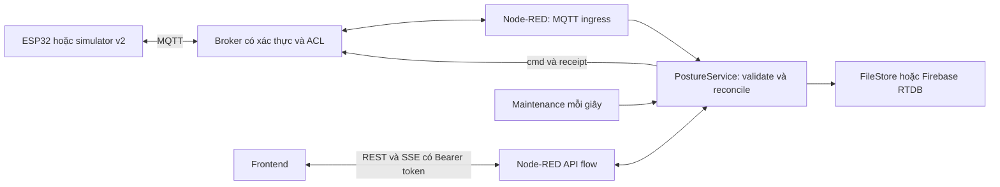

# Kiến trúc đang triển khai

Thiết kế dựa trên [PLAN](PLAN.md). Node-RED là runtime backend; ESP32 là nguồn tính góc, cung, thời lượng, histogram, sự kiện và điều khiển motor. Backend kiểm tra giao thức, điều phối lệnh và lưu kết quả; không tính một bộ thống kê tư thế thứ hai từ MQTT.

## Các phần đã có

- `backend/node-red/flows.json`: luồng nhận MQTT, validate/persist/receipt, maintenance và HTTP API.
- `backend/node-red/nodes/posture.js`: node/config node nạp service và adapter; mặc định tắt editor.
- `backend/logic/service.js`: một hàng đợi theo thiết bị, điều phối session/command, ACK/state, snapshot cộng dồn, event revision và history/report.
- `backend/integrations/mqtt/`: MQTT.js transport và validator v2; QoS publish của firmware vẫn theo khả năng PubSubClient.
- `backend/integrations/firebase/store.js`: FileStore nguyên tử dùng cho phát triển; Firebase Admin SDK dùng RTDB thật hoặc emulator.
- `frontend/assets/js/posture-api.js`: client ES module cho REST/SSE, không phụ thuộc framework.
- Simulator được gắn `simulated:true`, có preflight mô phỏng, ACK, state, telemetry, summary/final và retry tới receipt.

## Quyền sở hữu và tính nhất quán

Một instance Node-RED là writer cho một bộ thiết bị. Chưa hỗ trợ nhiều replica cùng điều phối một device; không chạy hai instance trên cùng dữ liệu/tài khoản MQTT. Root multi-location update của RTDB ghi command/control/session cùng một lần khi bắt đầu và xác nhận lệnh. ACK của broker không xác nhận thiết bị áp dụng.

Command được lưu trước publish. Retry cùng ID/nội dung, giữ deadline và target boot. Hết hạn chuyển `unknown`, giữ reservation, tiếp tục hỏi lại bằng đúng envelope để thiết bị trả kết quả cache hoặc `COMMAND_EXPIRED`. Không phát START mới từ pending cũ sau restart; chỉ retry khi có heartbeat mới của đúng boot.

State retained chỉ là thông tin lần cuối. Liveness cần state không retained có `state_seq` mới; telemetry không tự làm mới deadline của state. MQTT mất kết nối không chuyển phiên thành stopped. Boot thay đổi làm phiên đang chạy/pending bị interrupted/cancelled; dữ liệu cũ vẫn thuộc ID phiên cũ.

Telemetry có thể bỏ qua khi queue chịu tải. Summary/event/final phải retry và chỉ nhận receipt sau ghi bền thành công. Snapshot cộng dồn không được cộng lặp; event cũ không ghi đè revision mới. Queue tối đa 128 tác vụ/device; Firebase operation timeout 10 giây, MQTT publish timeout 2 giây.

Thông tin phiên nhỏ được cache có giới hạn; nhận telemetry không tải toàn bộ cây keyframe/event/summary. Khi ghi thay đổi phiên hoặc nhận lại summary đã commit sau timeout, cache được làm mới. Reservation lệnh được đối chiếu với lưu trữ để tránh tạo thêm phiên khi kết quả ghi trước đó chưa rõ.

## Lưu trữ và giao diện

File mode dùng `.runtime/store.json`, phục vụ chạy local; `cloud_status=not_configured`. Firebase mode dùng Admin SDK/ADC, rules từ chối client đọc/ghi trực tiếp. Backend không gửi service-account credential cho frontend.

Phiên lưu config snapshot bất biến; reference chỉ ghi là đã áp dụng sau ACK/config từ thiết bị. Live data đi SSE; keyframe lưu tối đa mỗi 5 giây theo thời điểm backend nhận. Lịch sử không phải bản lưu đầy đủ 10 Hz. REST phân trang bằng cursor; SSE reconnect nhận snapshot mới, không phát lại mọi event cũ.

Báo cáo dùng `Asia/Ho_Chi_Minh`, nhóm theo ngày bắt đầu phiên; tổng mỗi phiên lấy final hoặc snapshot mới nhất và đánh dấu chưa hoàn tất. Thời gian thiết bị chưa đồng bộ được ghi `received_estimate`.

## Ranh giới hiện tại

Firmware trong repo còn giao thức cũ; chưa có session manager, state v2, curve builder, SET_REFERENCE hoặc motor driver đáp ứng contract này. Xem [hướng dẫn thiết bị](device-integration.md). Backend không giả session/boot cho dữ liệu cũ. Chưa triển khai giao diện dashboard hoàn chỉnh, gửi email thực, journal firmware hoặc triển khai cloud có tài khoản thật.

Tham khảo API runtime chính thức: [Node-RED configuration](https://nodered.org/docs/user-guide/runtime/configuration), [custom nodes](https://nodered.org/docs/creating-nodes/node-js), [Firebase emulator/Admin SDK](https://firebase.google.com/docs/emulator-suite/connect_rtdb).
