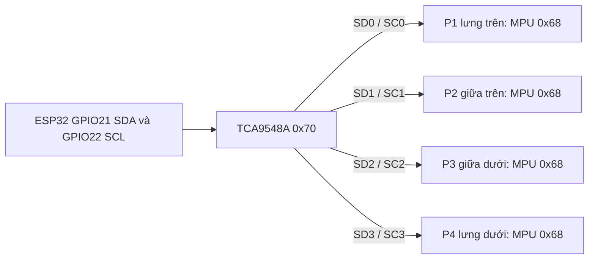

# Phần cứng — ESP32 + TCA9548A + 4 MPU6050

Tài liệu dành cho người nhận lại mạch và firmware. Bảng nối dưới đây khớp **source hiện tại**, chưa phải kết quả kiểm tra trên mạch đã lắp. Chưa có ảnh/schematic của đúng breakout thực tế trong repository, nên cần đối chiếu nhãn chân và nguồn của module đang dùng.

**Đọc được bốn MPU không đồng nghĩa backend đã nhận được dữ liệu.** Firmware hiện vẫn dùng MQTT legacy, chưa auth với broker mặc định và chưa có contract v2. Xem [tích hợp thiết bị thật](../docs/device-integration.md).

## 1. Chuẩn bị

- Một board ESP32 classic phù hợp cấu hình PlatformIO `esp32dev`, cáp USB truyền dữ liệu và driver USB-UART tương ứng board.
- Một breakout TCA9548A, bốn breakout MPU6050, dây/breadboard hoặc mạch đã hàn.
- Breakout và nguồn phù hợp phương án logic 3.3 V; kiểm tra sơ đồ của đúng module trước khi nối VIN/VCC.
- Đồng hồ đo để kiểm tra nguồn/GND; máy tính cài PlatformIO và Serial Monitor.
- Wi-Fi 2.4 GHz cho ESP32 classic; máy chạy broker nằm cùng LAN và không bị client isolation.

GPIO21/22 là **số GPIO**, không phải vị trí chân thứ 21/22 trên hàng header. ESP32-C3/S3 hoặc board khác không tự dùng được bảng này nếu chưa đổi pin/board và kiểm tra lại.

## 2. Sơ đồ đấu mạch

### 2.1. ESP32 → TCA9548A

| ESP32 | TCA9548A | Ý nghĩa |
|---|---|---|
| GPIO21 | SDA phía upstream | Đường dữ liệu I2C |
| GPIO22 | SCL phía upstream | Xung clock I2C |
| GND | GND | Mass chung |
| Nguồn 3.3 V phù hợp module | VCC/VIN theo sơ đồ breakout | Chọn mức logic 3.3 V trong phương án này |
| GND | A0, A1, A2 | Địa chỉ 7-bit `0x70`; kiểm tra jumper/pull-down sẵn có |
| Không có GPIO reset được cấu hình | RESET/RST | Giữ HIGH bằng pull-up tới nguồn logic theo module; không nối xuống GND khi chạy |

TI quy định A0/A1/A2 chọn địa chỉ và RESET cần pull-up; khi cả ba chân địa chỉ LOW thì địa chỉ là `0x70`. TCA bật các nhánh I2C độc lập để dùng nhiều thiết bị cùng địa chỉ. [Datasheet TCA9548A, §7.4–7.5](https://www.ti.com/lit/ds/symlink/tca9548a.pdf).

Firmware gọi `Wire.begin(21,22)`, clock I2C 100 kHz và timeout 20 ms. Cấu hình nằm trong [sensor_setup.h](firmware/include/sensor_setup.h) và [sensor_setup.cpp](firmware/src/sensor_setup.cpp).

### 2.2. TCA9548A → từng MPU6050

| Vị trí trên lưng | Kênh TCA | TCA → SDA MPU | TCA → SCL MPU | Index trong code |
|---|---:|---|---|---:|
| P1 — lưng trên cùng | 0 | SD0 → SDA | SC0 → SCL | 0 |
| P2 — giữa trên | 1 | SD1 → SDA | SC1 → SCL | 1 |
| P3 — giữa dưới | 2 | SD2 → SDA | SC2 → SCL | 2 |
| P4 — lưng dưới cùng | 3 | SD3 → SDA | SC3 → SCL | 3 |

Trên một số breakout, SD0/SC0 được in SDA0/SCL0; kiểm tra đúng sơ đồ module. Bốn MPU dùng nguồn phù hợp 3.3 V và GND chung; nguồn không đi qua SDn/SCn. AD0 của mỗi MPU phải giữ LOW để khớp `MPU_ADDR=0x68` trong code. Nếu chọn 0x69, source hiện tại sẽ không đọc đúng vì địa chỉ slave đang cố định 0x68.

INT, XDA, XCL của MPU không được firmware hiện tại dùng; không nối chúng thay SDA/SCL. Với IC trần thay vì breakout, phải thiết kế đủ nguồn/decoupling/VLOGIC theo datasheet; bảng này không phải schematic cho IC trần. Thông tin linh kiện gốc: [TDK MPU-6050](https://product.tdk.com/en/search/sensor/mortion-inertial/imu/info?part_no=MPU-6050).



Không đấu cả bốn MPU cùng 0x68 trực tiếp vào một nhánh SDA/SCL. Firmware chọn **một** kênh TCA bằng bit `1 << channel` rồi giao tiếp với MPU trên kênh đó.

### 2.3. Nguồn, pull-up và dây nối

1. Tắt nguồn trước khi thay dây. Xác định đúng 3V3, GND, SDA, SCL theo nhãn board.
2. Giữ toàn bộ đường I2C nối với ESP32 ở mức logic 3.3 V; không kéo SDA/SCL của ESP32 lên 5 V. Nguồn USB 5 V vào đầu USB của dev board khác với mức logic GPIO. [Đặc tính điện ESP32](https://documentation.espressif.com/esp32_datasheet_en.html).
3. Nhiều breakout có sẵn pull-up/ổn áp nhưng thiết kế khác nhau. Kiểm tra upstream và từng nhánh downstream có pull-up phù hợp, về đúng nguồn logic; không cộng điện trở pull-up một cách máy móc khi module đã có. [Hướng dẫn chân breakout TCA của Adafruit](https://learn.adafruit.com/adafruit-tca9548a-1-to-8-i2c-multiplexer-breakout/pinouts).
4. Giữ dây I2C ngắn, GND chắc; nếu chuyển sang dây dài trên đai cần kiểm chứng độ ổn định thực tế.
5. Chưa có driver motor/chân rung được chốt trong firmware này. Không nối motor trực tiếp vào GPIO hoặc giả định có đầu ra rung chỉ vì dashboard có nút mô phỏng.

## 3. Gắn cảm biến và đo khoảng cách

- Dán nhãn vật lý P1/P2/P3/P4 và kênh 0/1/2/3 trước khi đeo.
- Giữ hướng trục của các module nhất quán; kiểm tra với đồ gá ở 0°, nghiêng trước và nghiêng sau. WHO_AM_I không cho biết module đang ở vị trí nào trên lưng.
- Đo `d12`, `d23`, `d34` **dọc theo đai** giữa các vị trí đo, ghi rõ mm hoặc cm; không mặc định ba khoảng cách bằng nhau.
- F02.1 dựng từ P4 lên P1, giữ góc nghiêng tuyệt đối P4; không tự zero cả bốn góc để làm đường trông thẳng.
- Firmware hiện chưa có lưu calibration/mounting/mapping/geometry revisions. Các trường cấu hình khoảng cách trong dashboard hiện chỉ tác động mô phỏng, chưa gửi xuống ESP32.

Xem [giải thích đo góc và dựng cung](../docs/F02.1-giai-thich.md) để hiểu ý nghĩa Pitch, góc tương đối và cách xử lý dấu.

## 4. Nạp firmware và kiểm tra mạch

### 4.1. Cấu hình build và các chỗ cần xem

| File | Thông tin người nối mạch cần biết |
|---|---|
| `firmware/platformio.ini` | `esp32dev`, Arduino, Serial 115200, PubSubClient và ArduinoJson |
| `firmware/include/sensor_setup.h` | SDA=21, SCL=22, TCA=0x70, MPU=0x68, bốn cảm biến |
| `firmware/src/sensor_setup.cpp` | Chọn kênh, WHO_AM_I=0x68, cấu hình ±2 g/±250°/s |
| `firmware/src/mpu_reader.cpp` | Đọc accel/gyro và timestamp micros() |
| `firmware/src/angle_calculator.cpp` | Lọc Pitch, status 1/0 và relative legacy |
| `firmware/src/main.cpp` | Sensor task, MQTT task, queue frame mới nhất |
| `firmware/src/mqtt_handler.cpp` | Placeholder Wi-Fi/broker, topic, START/STOP/CONFIG và JSON cũ |

`WIFI_SSID`, `WIFI_PASS`, `MQTT_HOST`, `MQTT_PORT` hiện là hằng số trong mqtt_handler.cpp. `192.168.1.100` chỉ là địa chỉ mẫu, không tự tìm broker. `DEVICE_ID` và ba TOPIC_* cũng đang viết cố định; đổi ID phải đổi topic tương ứng. `backend/.env` không tự được firmware đọc. Không commit mật khẩu Wi-Fi/MQTT thực; trước khi dùng thật nên tách credential sang cấu hình riêng được Git ignore.

### 4.2. Lệnh PlatformIO

Từ root repository, chọn đúng COM bằng `pio device list`:

```powershell
pio device list
pio run -d hardware/firmware
pio run -d hardware/firmware -t upload --upload-port COM5
pio device monitor -d hardware/firmware -p COM5 -b 115200
```

`COM5` là ví dụ, thay theo máy. Trên Linux/macOS dùng đúng đường thiết bị. Đóng Serial Monitor trước khi upload nếu cổng bị giữ. Nếu board không tự vào bootloader, dùng quy trình BOOT/EN của đúng dev board.

Các lệnh là quy trình cho source PlatformIO hiện có; chưa được chạy build/upload ESP32 trong môi trường bàn giao này. Bộ test C++ host không thay cho bước build/upload.

Tham khảo tùy chọn port/baud/project-dir của [PlatformIO Serial Monitor](https://docs.platformio.org/en/latest/core/userguide/device/cmd_monitor.html).

### 4.3. Kết quả Serial cần thấy

Sau reset, phần khởi tạo in một lần:

```text
MPU 0: READY
MPU 1: READY
MPU 2: READY
MPU 3: READY
```

Đây là log kỳ vọng theo source, **không phải log thu được từ phần cứng đã thử**. READY nghĩa bước I2C/identity/config thành công; chưa xác nhận hướng lắp hay độ chính xác góc. Main hiện chưa dừng khởi động khi setupSensors() trả false, nên cần tự kiểm tra đủ bốn dòng trước khi đi tiếp.

Khi MQTT thành công có `MQTT connected`; nếu lỗi có `MQTT failed: <code>`. Hiện không có log Wi-Fi IP hay in liên tục bốn Pitch ra Serial. Serial Monitor trống sau các log khởi động chưa đủ kết luận sensor hỏng.

**Firmware mặc định chưa đo liên tục ngay sau boot.** `measurementRunning=false`; sensor task chỉ đọc frame khi nhận MQTT START. Chu kỳ task đặt 20 ms (mục tiêu khoảng 50 Hz); publish mặc định 100 ms (khoảng 10 Hz). Đây là lịch cấu hình, chưa đo được tần suất thực trên đồ gá.

### 4.4. Payload và lệnh của firmware hiện tại

Firmware subscribe `posture/esp32_01/cmd`, publish `posture/esp32_01/ack` và `/data`. Nó đang gọi `mqtt.connect(DEVICE_ID)` — **chưa gửi username/password**, nên broker có auth của dự án sẽ từ chối.

Trên một môi trường bench riêng đã cấu hình MQTT phù hợp, callback legacy hiểu các payload sau:

```json
{"command_id":"bench_start_001","command":"START"}
```

```json
{"command_id":"bench_rate_001","command":"CONFIG","publish_interval_ms":100}
```

```json
{"command_id":"bench_stop_001","command":"STOP"}
```

Đây là ví dụ để đọc hiểu/kiểm tra firmware legacy, **không phải cách START phiên v2 qua backend**. Không dùng chúng để giả lập việc backend đã cấp session. CONFIG legacy chấp nhận số nguyên 50..5000 ms. ACK legacy dùng status `ok`/`error`, khác `accepted`/`applied`/`rejected` của v2.

Ví dụ JSON đúng hình dạng firmware phát, số bên dưới chỉ để minh họa:

```json
{
  "device_id":"esp32_01",
  "timestamp_us":1000000,
  "pitch":[30,20,10,0],
  "relative":[-10,-10,-10],
  "status":[1,1,1,1]
}
```

Thiếu sensor: vị trí pitch và relative liên quan là null. `relative` legacy tính góc dưới trừ góc trên; SPT/F02.1 dùng dấu ngược. `timestamp_us` là micros() 32 bit, không phải Unix time. Không gửi timestamp này như ngày/giờ hoặc coi nó là bằng chứng đồng bộ cả bốn sensor.

## 5. Kết nối Wi-Fi/MQTT tới máy tính

ESP32 phải trỏ tới **IPv4 LAN của máy chạy broker**, ví dụ 192.168.1.100:1883, không dùng 127.0.0.1. Cùng Wi-Fi chưa chắc truy cập được nếu đang ở guest network/client isolation. Broker mặc định `npm run broker` chỉ bind loopback; Docker Compose mặc định cũng chỉ publish loopback. Cách chuẩn bị listener LAN có auth/ACL nằm trong [device-integration.md](../docs/device-integration.md#3-chuẩn-bị-broker-lan-cho-esp32).

Cần hoàn thiện cả ba việc: broker có thể truy cập từ LAN; firmware gửi credential thiết bị; firmware đáp ứng v2. Chỉ sửa Wi-Fi/IP hoặc chỉ thêm auth chưa nối được backend hiện tại. Không chạy simulator và ESP32 cùng client/device ID đồng thời.

## 6. Tìm lỗi theo từng chặng

| Hiện tượng | Kiểm tra trước |
|---|---|
| Không có COM | Cáp dữ liệu, driver USB-UART, cổng USB, board được cấp nguồn |
| Serial ra ký tự lỗi | Baud 115200, đúng COM, reset lại board |
| Cả bốn MPU FAILED | GND/nguồn, GPIO21/22, SDA/SCL bị đảo, TCA 0x70, RESET bị LOW |
| Một MPU FAILED | Đúng cặp SDn/SCn, AD0/0x68, nguồn và mối nối của nhánh đó |
| Scanner không thấy bốn MPU trên bus chính | Phải chọn từng kênh TCA; cùng địa chỉ 0x68 không hiện thành bốn địa chỉ |
| Có READY nhưng không có /data | MQTT chưa kết nối, chưa START hoặc đang STOP; firmware không tự stream ngay sau boot |
| MQTT failed | Wi-Fi 2.4 GHz, đúng IP, listener LAN/firewall; source hiện thiếu auth với broker dự án |
| Broker có JSON nhưng API không thấy telemetry | Schema legacy bị từ chối, thiếu state/session/revision v2; xem log backend |
| API đã có telemetry mà dashboard vẫn mô phỏng | Adapter production chưa được triển khai; dashboard demo không đọc API tự động |
| Góc ngược/khác vị trí | Mapping 0..3, hướng trục, cách gắn, dấu relative legacy; cần kiểm chuẩn ngoài |

Chưa có I2C scanner utility riêng trong repo; không suy ra chỉ một địa chỉ 0x68 trên scanner nghĩa chỉ một module hoạt động. Firmware tự chọn lần lượt kênh để khởi tạo.

## 7. Checklist bàn giao mạch

- [ ] Ghi đúng model ESP32, model/schematic breakout, nguồn sử dụng và ảnh nhãn dây.
- [ ] Xác nhận logic 3.3 V, GND chung, RESET/pull-up đúng, không chập nguồn.
- [ ] Ghi rõ P1↔kênh0 ... P4↔kênh3; đủ bốn READY sau reset.
- [ ] Build/upload được đúng board/port; lưu commit và log thực tế.
- [ ] Kiểm tra góc 0°, nghiêng trước/sau bằng chuẩn ngoài; ghi orientation/calibration.
- [ ] Đo d12/d23/d34 dọc đai, ghi đơn vị; không mặc định 70 mm.
- [ ] Ghi broker LAN/port/device ID, cách quản lý credential, không ghi password vào README.
- [ ] Hoàn thiện và kiểm tra contract v2/heartbeat/START/STOP; không chỉ nhìn log MQTT connected.
- [ ] API xác nhận telemetry thật; frontend có adapter và nhãn nguồn dữ liệu đúng.

Những ô trên là việc cần xác nhận trên mạch thật, chưa được đánh PASS trong lần viết tài liệu này.
